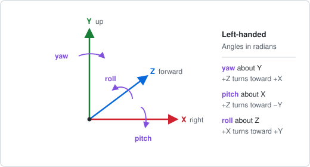

# Conventions

[← Back to the README](../README.md)

This page describes the rules that hold across the whole library. Reading it once makes the rest of the API
predictable.

- [Namespaces and type names](#namespaces-and-type-names)
- [Precision](#precision)
- [Coordinate system](#coordinate-system)
- [Vectors and matrices](#vectors-and-matrices)
- [Order of composition](#order-of-composition)
- [Rotations](#rotations)
- [Planes and half-spaces](#planes-and-half-spaces)
- [API naming](#api-naming)
- [Construction tags](#construction-tags)
- [Normalized and unnormalized queries](#normalized-and-unnormalized-queries)
- [Tolerances and comparisons](#tolerances-and-comparisons)
- [Empty values](#empty-values)
- [Error handling](#error-handling)
- [SIMD](#simd)
- [Strict aliasing](#strict-aliasing)
- [Standard library integration](#standard-library-integration)

## Namespaces and type names

Everything lives in the `mathematics` namespace.

| Namespace | Contents |
| --- | --- |
| `mathematics` | Type aliases (`Vector3`, `Sphere`, ...), scalar functions, `Constants`, `Random`, `Axis`, `EulerOrder`, tags |
| `mathematics::templates` | The class templates themselves (`templates::Vector3<T>`) and their free functions |
| `mathematics::intersections`, `distances`, `containment` | Low-level query functions that work on raw parameters |
| `mathematics::lu`, `romberg`, `bezier`, `hermite`, `perlin`, `triangulation` | Numeric helpers |

The free functions of a type (`dot`, `normalize`, `transform`, `inverse`, ...) are declared next to the template in
`mathematics::templates` and are found through argument-dependent lookup, so they can be called unqualified:

```cpp
mathematics::Vector3 n = normalize(cross(a, b));    // no using-directive required
```

## Precision

Every type is a template over a floating point type. The header of each type ends with aliases:

| Alias | Meaning |
| --- | --- |
| `Vector3` | `templates::Vector3<float>`, or `templates::Vector3<double>` when `MATHEMATICS_DOUBLE_PRECISION` is on |
| `Vector3f`, `Vector3d` | Always `float` and `double`. Available for `Vector2/3/4` and `Matrix2/3/4` |
| `IntVector2`, `IntVector3`, `IntVector4` | `templates::VectorN<int>` |
| `Vector3Arg`, `Vector3Result` | The preferred way to pass and return the type (see [SIMD](#simd)) |

Other precisions can always be named through the template, for example `templates::Sphere<double>`. Types of different
precision convert explicitly:

```cpp
Vector3d precise(1.0, 2.0, 3.0);
Vector3f compact(precise);          // explicit conversion
```

Each floating point type exposes its scalar type as the member alias `Real`.

## Coordinate system

The library uses a **left-handed** coordinate system with **X pointing right, Y up and Z forward**.

<p align="center">
  
</p>

This matters wherever a direction has a meaning: the "look at" constructors of `Matrix3` and `AffineTransform`,
`YawPitchRoll`, and `SymmetricFrustum`, which looks along the Z axis of its basis. The plain algebra
(`cross(UNIT_X, UNIT_Y) == UNIT_Z`) is the same in either handedness.

All angles are in **radians**. `radians(x)` and `degrees(x)` convert between the two.

## Vectors and matrices

Vectors are **row vectors** and are transformed by multiplying with the matrix on the right:

```cpp
Vector3 v = Vector3::UNIT_X*Matrix3::makeRotation(Axis::Z, radians(90.f));  // ~(0, 1, 0)
```

`transform(v, m)` and `v.transform(m)` are equivalent to `v*m`.

Matrices are stored in **row-major** order. The element `mRC` is at row `R` and column `C`, `m[i]` returns row `i` as
a vector, and the rows of a rotation matrix are the transformed X, Y and Z axes:

```
Matrix3                      AffineTransform              Matrix4

| m00 m01 m02 |  X axis      | m00 m01 m02 |  X axis      | m00 m01 m02 m03 |
| m10 m11 m12 |  Y axis      | m10 m11 m12 |  Y axis      | m10 m11 m12 m13 |
| m20 m21 m22 |  Z axis      | m20 m21 m22 |  Z axis      | m20 m21 m22 m23 |
                             | m30 m31 m32 |  origin      | m30 m31 m32 m33 |  translation in m30..m32
```

The reverse product `m*v` is also defined and treats `v` as a column vector, which is the same as multiplying by the
transposed matrix. For a pure rotation it applies the inverse rotation.

## Order of composition

With row vectors, transformations are applied **left to right**:

```cpp
AffineTransform move = AffineTransform::makeTranslation(Vector3(1.f, 0.f, 0.f));
AffineTransform grow = AffineTransform::makeScaling(2.f);

transform(Vector3(1.f, 1.f, 1.f), concatenate(move, grow));     // (4, 2, 2): moved first, then scaled
```

| Expression | Result |
| --- | --- |
| `concatenate(a, b)` | Applies `a`, then `b` |
| `a.concatenate(b)` | `a` becomes "`a`, then `b`" |
| `a*b`, `a *= b` | The same as `concatenate`; available for `Matrix2/3/4` (not for `AffineTransform`) |
| `a.preConcatenate(b)` | `a` becomes "`b`, then `a`" |
| `m.scale(v)`, `m.translate(v)` | The scale or translation is applied after `m` |
| `m.preScale(v)` | The scale is applied before `m` |

The names of the combined factory functions list their parts in the order of application:
`makeScalingRotationTranslation(s, r, t)` scales, then rotates, then translates.

Quaternions follow the same rule for `concatenate`, but **not** for `operator*`, which is the mathematical Hamilton
product:

| Expression | Result |
| --- | --- |
| `concatenate(q1, q2)` | Rotates by `q1`, then by `q2` |
| `q1*q2` | Rotates by `q2`, then by `q1` |
| `q1.concatenate(q2)` | `q1` becomes "`q1`, then `q2`" |
| `q1.preConcatenate(q2)`, `q1 *= q2` | `q1` becomes "`q2`, then `q1`" |

## Rotations

A rotation by a positive angle about an axis turns the next axis toward the one after it, in the cyclic order X, Y, Z:

| Rotation | Effect of a positive angle |
| --- | --- |
| About X | +Y turns toward +Z |
| About Y | +Z turns toward +X |
| About Z | +X turns toward +Y |

Matrices, quaternions and axis-angle constructors all agree on this direction.

**Quaternions** store the vector part in `x, y, z` and the scalar part in `w`. The identity is `(0, 0, 0, 1)`.

**Euler angles** carry their order explicitly. `EulerOrder::XYZ` means "rotate about X, then about Y, then about Z":

```cpp
Euler e(radians(10.f), radians(20.f), radians(30.f), EulerOrder::XYZ);

Matrix3::makeRotation(e);   // == makeRotation(Axis::X, e.x)*makeRotation(Axis::Y, e.y)*makeRotation(Axis::Z, e.z)
```

**Yaw, pitch and roll** is the `ZXY` order, that is roll about Z, then pitch about X, then yaw about Y:

| Angle | Axis | Effect of a positive angle |
| --- | --- | --- |
| Yaw | Y (up) | Turns the forward direction from +Z toward +X (to the right) |
| Pitch | X (right) | Tilts the forward direction from +Z toward -Y (downward) |
| Roll | Z (forward) | Turns the right direction from +X toward +Y |

## Planes and half-spaces

A `Plane` stores the coefficients `a, b, c, d` of the equation

```
a*x + b*y + c*z + d = 0        i.e.  dot(normal, p) + d = 0
```

- `getNormal()` returns `(a, b, c)` and `getConstant()` returns `d`.
- The signed distance of a point is positive on the side the normal points to.
- A `HalfSpace` has the same representation and **contains** the points where `dot(normal, p) + d <= 0`. Its normal
  therefore points *out* of the half-space, and convex volumes built from half-spaces (`ConvexPolyhedron`, the
  half-spaces of boxes and frustums) have outward-pointing normals.

```cpp
Plane plane(Vector3::UNIT_Y, Vector3(0.f, 2.f, 0.f));      // the plane y = 2; stored as (0, 1, 0, -2)
plane.getSignedDistanceTo(Vector3(0.f, 5.f, 0.f));         // 3
```

## API naming

| Pattern | Meaning | Example |
| --- | --- | --- |
| Member verb | Modifies the object in place and returns `*this`, so calls can be chained | `v.normalize()`, `m.transpose()`, `m.invert()` |
| Free function | Leaves its arguments alone and returns a new value | `normalize(v)`, `transpose(m)`, `inverse(m)` |
| `static makeX(...)` | Creates a new value | `Matrix3::makeRotation(axis, angle)` |
| `setX(...)` | Overwrites the object with the same result as `makeX` | `m.setRotation(axis, angle)` |
| `getX()` / `setX(value)` | Accessors for stored or derived properties | `sphere.getRadius()`, `box.getCenter()` |
| `computeX()` | A derived property that is expensive to evaluate | `mesh.computeVolume()` |
| `isX()`, `hasX()` | Predicates | `m.isIdentity()`, `box.isEmpty()` |
| `isApproxX()`, `approxEquals()` | Predicates with a tolerance | `v.isApproxZero()` |
| `contains`, `intersects`, `findIntersection`, `getDistanceTo`, `getClosestPoint` | Geometric queries, see [Queries](Queries.md) | `box.intersects(sphere)` |

Most types are plain structs with public data members (`v.x`, `sphere.radius`, `box.minimum`), so the accessors are a
convenience rather than a requirement.

Constants are `static const` members in upper case: `Vector3::ZERO`, `Vector3::UNIT_X`, `Matrix3::IDENTITY`,
`Quaternion::IDENTITY`, `AxisAlignedBox::EMPTY`.

## Construction tags

Default constructors initialize to **zero** (not to identity) unless the type has a meaningful empty state.

```cpp
Matrix3 zero;                           // all zeros
Matrix3 identity{ Identity() };         // identity matrix; same as Matrix3::IDENTITY
Quaternion rotation{ Identity() };      // (0, 0, 0, 1)

Vector3 scratch(UNINITIALIZED);         // no initialization at all; assign before reading
```

| Tag | Use |
| --- | --- |
| `Identity` (type) | `Matrix2/3/4`, `AffineTransform`, `Quaternion` constructors |
| `Uninitialized` (type), `UNINITIALIZED` (constant) | Skips initialization in performance-critical code |
| `Normalized`, `Unnormalized` (types) | Template arguments for queries, see below |

## Normalized and unnormalized queries

Lines, rays, planes and half-spaces do not normalize their direction or normal automatically. Queries whose formula
depends on a unit-length direction come in two flavors:

```cpp
Line3 line(Vector3(0.f, 1.f, 0.f), Vector3(2.f, 0.f, 0.f));    // direction is not unit length

line.getDistanceTo<Unnormalized>(Vector3(0.f, 4.f, 0.f));      // 3; correct for any direction
line.normalize();
line.getDistanceTo(Vector3(0.f, 4.f, 0.f));                    // 3; the plain overload assumes a normalized line
```

The overload without a template argument is the fast path and **assumes normalized input**. Pass `Unnormalized`
explicitly when that is not guaranteed, or call `normalize()` once up front. `Normalized` may be passed explicitly in
generic code.

## Tolerances and comparisons

`operator==` compares exactly. For floating point results use the approximate predicates, which use an **absolute**
tolerance on each component:

```cpp
approxEquals(0.1f + 0.2f, 0.3f);            // scalars
a.approxEquals(b);                          // default tolerance
a.approxEquals(b, 1e-3f);                   // explicit tolerance
v.isApproxZero();
m.isApproxOrthogonal();
```

The default tolerance is `Constants<T>::TOLERANCE`: `1e-6` for `float` and `1e-15` for `double`. Because it is
absolute, pass an explicit tolerance when working with large magnitudes.

## Empty values

Bounding types have an *empty* state that behaves as the identity for unions, so a bound can be accumulated from
nothing:

```cpp
AxisAlignedBox bounds;                      // empty; same as AxisAlignedBox::EMPTY
for (const Vector3& point : points)
    bounds.extendBy(point);
```

`Interval`, `AxisAlignedRectangle` and `AxisAlignedBox` are empty when the minimum exceeds the maximum; the empty
constant is stored as `(+infinity, -infinity)`. Use `isEmpty()` to test and `clear()` to reset.

## Error handling

- Almost all functions are `noexcept`. Degenerate input (zero-length vectors, singular matrices) does not throw; where
  a meaningful fallback exists it is used, for example the "look at" constructors fall back to identity.
- Queries that may have no answer return `std::optional`.
- Indexed setters on polygons, curves and meshes (`setVertex`, `setControlPoint`, `insertVertex`, ...) throw
  `std::out_of_range` for an invalid index. The matching getters return a zero value instead.
- `operator[]` performs no bounds checking.

## SIMD

When `MATHEMATICS_HAS_SIMD` is on and the target supports it (currently SSE on x86 and x86-64), the **single
precision** `Vector2`, `Vector3`, `Vector4`, `Matrix2`, `Matrix3`, `Matrix4`, `AffineTransform`, `Quaternion`, `Plane`
and `HalfSpace` are replaced by specializations built on 4-float registers. Double precision and integer types always
use the portable implementation.

The API is the same, with these consequences:

| Aspect | Portable | SIMD (`float`) |
| --- | --- | --- |
| Alignment of the listed types | 4 bytes | 16 bytes |
| `sizeof(Vector2)`, `sizeof(Vector3)` | 8, 12 | 16, 16 |
| `sizeof(Matrix3)`, `sizeof(AffineTransform)` | 36, 48 | 48, 64 |
| `sizeof(Sphere)`, `sizeof(AxisAlignedBox)`, `sizeof(Ray3)` | 16, 24, 24 | 32, 32, 32 |
| `Vector3Arg`, `Vector3Result` | `const Vector3&` | `const Vector3` (passed in a register) |
| Constructors | `constexpr` | not `constexpr` |
| `v.xy()` and similar sub-vector accessors | return a reference | return a value |

Practical guidance:

- **Do not assume a packed layout.** An array of `Vector3` is not an array of three-float triples in SIMD builds. To
  exchange data with graphics APIs or files, convert explicitly through the `const float*` constructor, the tuple
  conversions, or component access.
- **Use the `Arg` and `Result` aliases in your own signatures** (`Vector3Arg`, `Matrix3Arg`, ...) to get the optimal
  passing convention in both configurations.
- **Heap allocation is safe.** C++17 aligned `new` and the standard containers honor the 16-byte alignment.
- **Normalization is approximate by default.** The SIMD `normalize()` uses a fast reciprocal square root estimate,
  so the result may differ from unit length in the last few digits. Define `MATHEMATICS_FAST_NORMALIZE=0` for an
  exact square root and division.
- SIMD types convert to and from `simd::float4` and expose it through `as<simd::float4>()` for hand-written
  intrinsics.

## Strict aliasing

Several accessors return a reference to one type that views the storage of another, for example `Matrix3::operator[]`
returns a row as `Vector3&`, `AffineTransform::getBasis()` returns `Matrix3&` and `Plane::getNormal()` returns
`Vector3&`. This is only well defined when the compiler does not apply type-based alias analysis, so the CMake target
adds `-fno-strict-aliasing` for GCC, Clang, AppleClang and IntelLLVM. MSVC and clang-cl do not perform this
optimization.

**When building without the CMake target, add `-fno-strict-aliasing` yourself.**

## Standard library integration

**Structured bindings and tuples.** Vectors, quaternions, Euler angles, planes and half-spaces implement the tuple
protocol. These and most other value types (matrices, intervals, segments, triangles, boxes, ...) also convert to and
from a `std::tuple` of their members, named by the member alias `TupleType`:

```cpp
Vector3 v(1.f, 2.f, 3.f);
auto [x, y, z] = v;

std::tuple<float, float, float> t = v;
Vector3 w(t);
```

**Hashing.** `std::hash` is specialized for the value types, so they can be used as keys of unordered containers.

**Streams.** `operator<<` writes the components separated by single spaces, and `operator>>` reads the same format.
Composite types write their members in declaration order:

```cpp
std::cout << Vector3(1.f, 2.f, 3.f);                    // 1 2 3
std::cout << Sphere(Vector3::ZERO, 2.f);                // 0 0 0 2
std::cout << AxisAlignedBox(Vector3(-1.f), Vector3(1.f));   // -1 -1 -1 1 1 1
```

**Serialization.** Value types provide `template<typename A> void load(A&)` / `save(A&) const` (or a single
`serialize(A&)`) member functions that pass their members to a callable archive, `ar(x, y, z)`. This is the interface
used by [cereal](https://uscilab.github.io/cereal/) and compatible libraries; the library itself does not depend on
one.

**Raw access.** Vectors and matrices have explicit conversions to `T*` and `const T*`, and constructors from
`const T*`:

```cpp
float raw[3] = { 7.f, 8.f, 9.f };
Vector3 v(raw);
const float* p = static_cast<const float*>(v);
```
