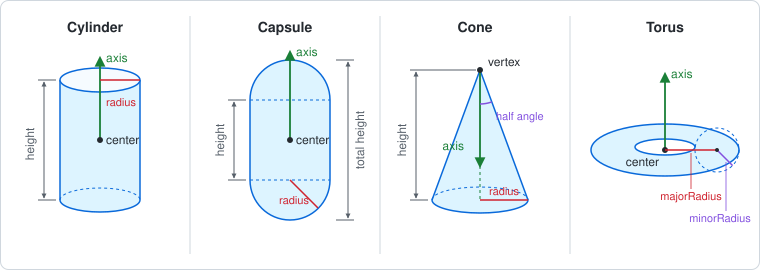
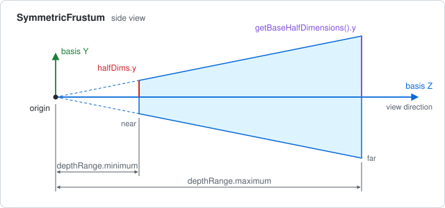

# Geometry

[← Back to the README](../README.md)

- [Overview](#overview)
- [Common interface](#common-interface)
- [Lines, rays and line segments](#lines-rays-and-line-segments)
- [Plane and HalfSpace](#plane-and-halfspace)
- [Triangle3, Quadrilateral3 and Tetrahedron](#triangle3-quadrilateral3-and-tetrahedron)
- [Axis-aligned boxes](#axis-aligned-boxes)
- [OrientedBox](#orientedbox)
- [Circle2, Sphere and Ellipsoid](#circle2-sphere-and-ellipsoid)
- [Cylinder, Capsule, Cone and Torus](#cylinder-capsule-cone-and-torus)
- [SymmetricFrustum](#symmetricfrustum)
- [Bezier curves](#bezier-curves)

This page describes how each primitive is defined and what it can tell about itself. The relationships *between*
primitives - containment, distance and intersection - are collected in [Queries](Queries.md). Convex polyhedra and
meshes are described in [Meshes](Meshes.md).

## Overview

All primitives are templates in `mathematics::templates` with an alias in `mathematics` for the default precision,
and each has its own header in `<Mathematics/Geometry/>` named after the type.

| Dimension | Type | Defined by |
| --- | --- | --- |
| 2D | `Line2`, `Ray2` | `origin`, `direction` |
| 2D | `LineSegment2` | `start`, `end` |
| 2D | `AxisAlignedRectangle` | `minimum`, `maximum` |
| 2D | `Circle2` | `center`, `radius` |
| 2D | `BezierCurve2` | 4 control points |
| 3D | `Line3`, `Ray3` | `origin`, `direction` |
| 3D | `LineSegment3` | `start`, `end` |
| 3D | `Plane`, `HalfSpace` | `a, b, c, d` (normal and constant) |
| 3D | `Triangle3`, `Quadrilateral3`, `Tetrahedron` | 3, 4 and 4 `vertices` |
| 3D | `AxisAlignedBox` | `minimum`, `maximum` |
| 3D | `OrientedBox` | `center`, `basis`, `halfDims` |
| 3D | `Sphere` | `center`, `radius` |
| 3D | `Ellipsoid` | `center`, `basis`, `radii` |
| 3D | `Cylinder`, `Capsule` | `center`, `axis`, `height`, `radius` |
| 3D | `Cone` | `vertex`, `axis`, `height`, `radius` |
| 3D | `Torus` | `center`, `axis`, `majorRadius`, `minorRadius` |
| 3D | `SymmetricFrustum` | `origin`, `basis`, `halfDims`, `depthRange` |
| 3D | `BezierCurve3` | 4 control points |

## Common interface

The primitives are plain value types with public data members and share a vocabulary:

| Member | Description |
| --- | --- |
| Default constructor | Zero-initializes, or creates the *empty* value for bounding types |
| `set(...)` | Reassigns all defining values, with the same parameters as the main constructor |
| `getX()`, `setX(value)` | Accessors for stored and derived properties |
| `isZero()`, `isApproxZero()`, `setZero()` | Zero state |
| `isFinite()` | No component is infinite or NaN |
| `approxEquals(other)`, `approxEquals(other, tolerance)` | Approximate comparison |
| `==`, `!=` | Exact comparison |
| `translate(offset)` | Moves the primitive |
| `transform(matrix)`, `transform(transformation)` | Applies a `Matrix3` (2D types: `Matrix2`) or an `AffineTransform` in place. Not available for `Circle2`, `AxisAlignedRectangle` and `SymmetricFrustum` |
| `getCircumscribedBox()`, `getCircumscribedSphere()` | Bounding volumes, where available |
| `operator<<`, `operator>>`, `std::hash` | Stream output and input, hashing |

## Lines, rays and line segments

`Line2`/`Line3` extend to infinity in both directions, `Ray2`/`Ray3` start at the origin and extend along the
direction, and `LineSegment2`/`LineSegment3` connect two points.

```cpp
Line3 line(Vector3(0.f, 1.f, 0.f), Vector3(1.f, 0.f, 0.f));    // origin, direction
Ray3 ray(Vector3(0.f, 0.f, -5.f), Vector3::UNIT_Z);
LineSegment3 segment(Vector3(-5.f, 0.f, 0.f), Vector3(5.f, 0.f, 0.f));

Line2 inclined(Vector2(0.f, 0.f), radians(45.f));               // 2D only: origin and inclination angle
```

Lines and rays share a representation and convert to each other: `ray.asLine()`, `line.asRay()`, `Line3(ray)` and
the explicit `Ray3(line)`. A segment can be cut out of a line or ray with a parameter interval:

```cpp
LineSegment3 part(Ray3(Vector3::ZERO, Vector3::UNIT_X), Interval(1.f, 3.f));    // from (1, 0, 0) to (3, 0, 0)
```

### Parameterization

`evaluate(t)` returns a point on the primitive:

| Type | `evaluate(t)` | Valid range |
| --- | --- | --- |
| Line | `origin + t*direction` | any `t` |
| Ray | `origin + t*direction` | `t >= 0` |
| Line segment | `start + t*(end - start)` | `0 <= t <= 1` |

Intersection queries return `t` in the same parameterization, so the hit point is always `evaluate(t)`. For lines and
rays `t` is a distance only when the direction has unit length.

> [!IMPORTANT]
> The direction is stored as given. The plain overloads of `getClosestPoint`, `getDistanceTo` and of the circle and
> sphere queries assume a **unit-length direction**. Call `normalize()` first, or use the `<Unnormalized>` overloads.
> See [Conventions](Conventions.md#normalized-and-unnormalized-queries).

### Members

| Member | Line | Ray | Segment | Description |
| --- | :-: | :-: | :-: | --- |
| `getOrigin()`, `getDirection()` and setters | ✓ | ✓ | | Defining values |
| `getStart()`, `getEnd()` and setters | | | ✓ | Defining values |
| `getDirection()`, `getLength()`, `getCenter()` | | | ✓ | `end - start` (not normalized), length, midpoint |
| `getEndpoints()`, `copyEndpoints(out)` | | | ✓ | Both endpoints |
| `normalize()` | ✓ | ✓ | | Makes the direction unit length |
| `evaluate(t)` | ✓ | ✓ | ✓ | Point at parameter `t` |
| `getClosestPoint(point)`, `getDistanceTo(point)` | ✓ | ✓ | ✓ | Nearest point on the primitive and its distance |
| `getSlope()`, `getInclinationAngle()` | 2D | 2D | 2D | Slope `dy/dx` and angle to the X axis |
| `isParallel(line)`, `isCoincident(line)` | 2D | | | Relationship of two lines |
| `getSignedDistanceTo(point)`, `getDistanceTo(line)`, `getSignedDistanceTo(line)` | 2D | | | Signed distances are positive on the left of the direction |

The free functions `normalize(line)` and `normalize(ray)` return normalized copies.

## Plane and HalfSpace

A `Plane` is the set of points with `dot(normal, p) + d == 0`. A `HalfSpace` has the same representation and is the
set of points with `dot(normal, p) + d <= 0`, so its normal points out of the solid side.

```cpp
Plane ground(Vector3::UNIT_Y, 0.f);                                 // normal, constant
Plane shelf(Vector3::UNIT_Y, Vector3(0.f, 2.f, 0.f));               // normal, a point on the plane
Plane face(Vector3(0.f, 0.f, 0.f), Vector3(1.f, 0.f, 0.f), Vector3(0.f, 1.f, 0.f));    // three points; normal (0, 0, 1)
Plane coefficients(0.f, 1.f, 0.f, -2.f);                            // a, b, c, d
```

The three-point constructor produces the normal `cross(p1 - p0, p2 - p0)`, normalized: counter-clockwise points give
a normal that faces the viewer.

| Member | Description |
| --- | --- |
| `getNormal()`, `setNormal(n)`, `getConstant()`, `setConstant(d)` | The normal `(a, b, c)` and the constant `d` |
| `normalize()` | Scales the equation so that the normal has unit length |
| `flip()` | Negates the equation, reversing the facing |
| `getDistanceTo(point)` | Distance to the plane. For a half-space: distance to the solid, `0` inside |
| `getSignedDistanceTo(point)` | Positive on the side of the normal |
| `contains(point)` | Plane: the point lies on the plane within the tolerance. Half-space: the point is inside |
| `translate(offset)`, `transform(m, orthogonal = false)` | Move the plane; pass `orthogonal = true` for pure rotations |
| `asHalfSpace()` / `asPlane()` | Reinterpret one as the other |

The distance functions assume a normalized equation; use `getDistanceTo<Unnormalized>(point)` otherwise. The free
function `normalize(plane)` returns a normalized copy.

```cpp
Plane plane(0.f, 2.f, 0.f, -4.f);                               // 2y - 4 = 0, i.e. y = 2
plane.getDistanceTo<Unnormalized>(Vector3(0.f, 5.f, 0.f));      // 3
plane.normalize();                                              // now (0, 1, 0, -2)
```

## Triangle3, Quadrilateral3 and Tetrahedron

Polygons and the tetrahedron store their vertices in the public array `vertices`.

```cpp
Triangle3 triangle(Vector3(0.f, 0.f, 0.f), Vector3(4.f, 0.f, 0.f), Vector3(0.f, 3.f, 0.f));

triangle.getArea();                 // 6
triangle.getPerimeter();            // 12
triangle.getNormal();               // (0, 0, 1): counter-clockwise vertices face the viewer
```

| Member | `Triangle3` | `Quadrilateral3` | `Tetrahedron` | Description |
| --- | :-: | :-: | :-: | --- |
| `getVertex(i)`, `setVertex(i, v)` | ✓ | ✓ | ✓ | `setVertex` throws `std::out_of_range` |
| `getVertices()`, `copyVertices(out)` | ✓ | ✓ | ✓ | All vertices as a tuple, or to an output iterator |
| `getPerimeter()`, `getArea()` | ✓ | ✓ | | |
| `getNormal()`, `static computeNormal(...)` | ✓ | ✓ | | Unit normal |
| `getVolume()`, `getCentroid()` | | | ✓ | |
| `getCircumscribedBox()` | ✓ | ✓ | ✓ | Axis-aligned bounds |
| `flip()` | ✓ | ✓ | ✓ | Reverses the winding |
| `translate(offset)`, `transform(m)` | ✓ | ✓ | ✓ | |

`Triangle3` additionally provides:

| Member | Description |
| --- | --- |
| `evaluate(v, w)`, `evaluate(u, v, w)` | Point from barycentric coordinates, `u*v0 + v*v1 + w*v2` with `u = 1 - v - w` |
| `getBarycentricCoords(point)` | Barycentric coordinates `(u, v, w)` of a point in the triangle's plane |
| `getClosestPoint(point)`, `getDistanceTo(point)` | Nearest point on the triangle |
| `getInscribedCircle()`, `getCircumscribedCircle()` | `std::pair` of center and radius |
| `getCircumscribedSphere()` | The circumscribed circle as a `Sphere` |
| `getTangentSpaceBasis(uv0, uv1, uv2, weightedByArea)` | Tangent, bitangent and normal for the given texture coordinates, as the rows of a `Matrix3` |
| `static triangulate(...)` | Triangulates a planar polygon; see [Meshes](Meshes.md#polygon-triangulation) |

```cpp
auto [incenter, inradius] = triangle.getInscribedCircle();      // (1, 1, 0) and 1
Vector3 middle = triangle.evaluate(0.5f, 0.5f);                 // (2, 1.5, 0): midpoint of the edge v1-v2
```

## Axis-aligned boxes

`AxisAlignedRectangle` (2D) and `AxisAlignedBox` (3D) are defined by their `minimum` and `maximum` corners. A default
constructed box is **empty**, which makes it the natural starting point for accumulating bounds.

```cpp
AxisAlignedBox box(Vector3(-1.f, -1.f, -1.f), Vector3(1.f, 1.f, 1.f));     // minimum, maximum
AxisAlignedBox centered(Vector3(2.f, 4.f, 6.f));                            // dimensions; centered at the origin

AxisAlignedBox bounds;                                                      // empty
bounds.extendBy(Vector3(1.f, 2.f, 3.f)).extendBy(Vector3(-1.f, 0.f, 0.f)); // (-1, 0, 0) to (1, 2, 3)
```

| Member | Description |
| --- | --- |
| `isEmpty()`, `clear()` | Empty state; `EMPTY` is the corresponding constant |
| `getMinimum()`, `getMaximum()` and setters | Corners |
| `getCenter()`, `getDimensions()`, `getHalfDimensions()` and setters | Derived placement and size; the setters keep the other property fixed |
| `getDiagonal()` | Length of the diagonal |
| `getVolume()`, `getSurfaceArea()` (3D); `getArea()`, `getPerimeter()` (2D) | Measures |
| `extendBy(point)`, `extendBy(box)`, `extendBy(sphere)` | Grows the box to include the argument (2D: point, rectangle, circle) |
| `inflate(halfDims)` | Grows the box by the given amount on every side |
| `scaleAroundCenter(factor)` | Scales the size, keeping the center |
| `setUnion(a, b)`, `setIntersection(a, b)`, `static makeUnion(a, b)`, `static makeIntersection(a, b)` | Set operations; an empty intersection yields an empty box |
| `getVertices()`, `copyVertices(out)` | The 4 or 8 corners |
| `getCircumscribedSphere()` (3D), `getCircumscribedCircle()` (2D) | Bounding sphere or circle |
| `getClosestPoint(point)`, `getDistanceTo(point)` | Nearest point of the solid box; the distance is `0` inside |
| `translate(offset)`, `transform(m)` (3D) | `transform` yields the axis-aligned bounds of the transformed box |

`AxisAlignedBox` can also describe itself as geometry:

| Member | Description |
| --- | --- |
| `getHalfSpaces()`, `copyHalfSpaces(out)` | The six faces as outward-facing half-spaces, in the order -X, +X, -Y, +Y, -Z, +Z |
| `getPrimitives<U>(n)` | A pair of pointers delimiting a static index list into `getVertices()`: `n = 2` for the 12 edges, `3` for 12 triangles, `4` for the 6 quads |
| `getPrimitiveCount(n)` | Number of primitives for the same `n` |

The corner order of `getVertices()` counts in binary with X as the lowest bit: `(-,-,-)`, `(+,-,-)`, `(-,+,-)`,
`(+,+,-)`, `(-,-,+)`, ...

`AxisAlignedBox` converts explicitly from an `OrientedBox`, giving its axis-aligned bounds.

## OrientedBox

A box with an arbitrary orientation: a `center`, a `basis` whose rows are the unit-length box axes, and the
half-dimensions `halfDims` along those axes.

```cpp
OrientedBox box(Vector3::ZERO, Matrix3::makeRotation(Axis::Z, radians(45.f)), Vector3(1.f, 1.f, 1.f));

box.contains(Vector3(1.2f, 0.f, 0.f));      // true: inside the rotated box, outside the unrotated one
box.getCircumscribedBox();                  // (-1.41421, -1.41421, -1) to (1.41421, 1.41421, 1)
```

An `OrientedBox` is typically created from an `AxisAlignedBox` and a transformation:

```cpp
OrientedBox worldBox(localBox, objectToWorld);          // AffineTransform or Matrix3
OrientedBox rigid(localBox, objectToWorld, true);       // the transformation is known to be orthonormal
```

Without the `orthogonal` flag the basis is orthonormalized and the scale of the transformation is moved into the
half-dimensions; shear cannot be represented and is discarded. An `AxisAlignedBox` converts implicitly to an
`OrientedBox`.

| Member | Description |
| --- | --- |
| `getCenter()`, `getBasis()`, `getHalfDimensions()`, `getDimensions()` and setters | Defining values |
| `getDiagonal()`, `getVolume()`, `getSurfaceArea()` | Measures |
| `getVertices()`, `copyVertices(out)`, `getHalfSpaces()`, `copyHalfSpaces(out)`, `getPrimitives<U>(n)`, `getPrimitiveCount(n)` | As for `AxisAlignedBox` |
| `getCircumscribedBox()`, `getCircumscribedSphere()` | Bounding volumes |
| `getClosestPoint(point)`, `getDistanceTo(point)` | Nearest point of the solid box |
| `translate(offset)`, `transform(m, orthogonal = false)`, `orthonormalize()` | |

## Circle2, Sphere and Ellipsoid

```cpp
Circle2 circle(Vector2(0.f, 0.f), 2.f);                                         // center, radius
Sphere sphere(Vector3::ZERO, 1.f);
Ellipsoid ellipsoid(Vector3::ZERO, Matrix3::IDENTITY, Vector3(1.f, 2.f, 3.f));  // center, basis, radii
```

| Member | `Circle2` | `Sphere` | `Ellipsoid` | Description |
| --- | :-: | :-: | :-: | --- |
| `getCenter()`, `setCenter(c)` | ✓ | ✓ | ✓ | |
| `getRadius()`, `getDiameter()` and setters | ✓ | ✓ | | |
| `getBasis()`, `getRadii()`, `getDiameters()` and setters | | | ✓ | Rows of the basis are the unit-length principal axes |
| `getCircumference()`, `getArea()` | ✓ | | | |
| `getSurfaceArea()` | | ✓ | | |
| `getVolume()` | | ✓ | ✓ | |
| `getDistanceTo(point)` | ✓ | ✓ | | Distance to the solid; `0` inside |
| `getSignedDistanceTo(point)` | ✓ | ✓ | | Negative inside |
| `getCircumscribedRectangle()` | ✓ | | | |
| `getCircumscribedBox()` | | ✓ | | |
| `getCircumscribedSphere()` | | | ✓ | Radius is the largest of the radii |
| `evaluate(point)` | | | ✓ | The implicit function: negative inside, `0` on the surface, positive outside |
| `getMatrix()`, `getInverseMatrix()` | | | ✓ | The quadratic form of the ellipsoid and its inverse |
| `orthonormalize()` | | | ✓ | Re-orthonormalizes the basis |
| `translate(offset)` | ✓ | ✓ | ✓ | |
| `transform(m, orthogonal = false)` | | ✓ | ✓ | |

A `Sphere` converts implicitly to an `Ellipsoid`, and an `Ellipsoid` can be built from a sphere and a transformation
(`Ellipsoid(sphere, transformation)`), which is how a sphere is carried through a rotation. The explicit
`Sphere(ellipsoid)` returns the circumscribed sphere.

## Cylinder, Capsule, Cone and Torus

<p align="center">
  
</p>

All four have an `axis`, which must have unit length. The constructors that take two points or an `Axis` value
guarantee this; after setting an arbitrary axis, call `normalize()`.

```cpp
Cylinder cylinder(Vector3::ZERO, Axis::Y, 2.f, 1.f);                    // center, axis, height, radius
Cylinder between(Vector3(0.f, 0.f, 0.f), Vector3(0.f, 4.f, 0.f), 1.f);  // two end points, radius

Capsule capsule(Vector3::ZERO, Axis::Y, 2.f, 0.5f);                     // height of the cylindrical part only
capsule.getTotalHeight();                                               // 3: height plus two radii

Cone cone(Vector3(0.f, 1.f, 0.f), Vector3(0.f, 0.f, 0.f), 1.f);         // apex, center of the base, base radius
degrees(cone.getHalfAngle());                                           // 45

Torus torus(Vector3::ZERO, Axis::Y, 2.f, 0.5f);                         // center, axis, major radius, minor radius
```

| Type | Defining values | Notes |
| --- | --- | --- |
| `Cylinder` | `center`, `axis`, `height`, `radius` | `center` is the midpoint of the axis |
| `Capsule` | `center`, `axis`, `height`, `radius` | `height` excludes the two hemispherical caps |
| `Cone` | `vertex`, `axis`, `height`, `radius` | `axis` points from the apex toward the base; `radius` is the base radius |
| `Torus` | `center`, `axis`, `majorRadius`, `minorRadius` | `majorRadius` is the distance from the center to the middle of the tube, `minorRadius` the radius of the tube |

| Member | `Cylinder` | `Capsule` | `Cone` | `Torus` | Description |
| --- | :-: | :-: | :-: | :-: | --- |
| Getters and setters for the defining values | ✓ | ✓ | ✓ | ✓ | `Cone` names the radius accessors `getBaseRadius` and `setBaseRadius` |
| `getHalfHeight()` | ✓ | ✓ | ✓ | | |
| `getTotalHeight()`, `setTotalHeight(h)` | | ✓ | | | Including the caps |
| `getBaseCenter()`, `setBaseCenter(c)` | | | ✓ | | |
| `getHalfAngle()`, `getAngle()` and setters | | | ✓ | | Angle between axis and side; full opening angle |
| `getSolidAngle()`, `getSlantHeight()` | | | ✓ | | |
| `getInnerRadius()`, `getOuterRadius()`, `getAspectRatio()` | | | | ✓ | `major - minor`, `major + minor`, `major/minor` |
| `getSurfaceArea()`, `getVolume()` | ✓ | ✓ | ✓ | ✓ | |
| `getCircumscribedBox()` | ✓ | ✓ | ✓ | ✓ | Returns an `OrientedBox` aligned with the axis |
| `getCircumscribedSphere()` | | | ✓ | | |
| `normalize()` | ✓ | ✓ | ✓ | | Makes the axis unit length |
| `translate(offset)`, `transform(m, orthogonal = false)` | ✓ | ✓ | ✓ | ✓ | |

## SymmetricFrustum

A truncated pyramid with a rectangular cross-section that is symmetric about its axis - the shape of a perspective
view volume.

<p align="center">
  
</p>

| Value | Description |
| --- | --- |
| `origin` | The apex of the pyramid (the eye point) |
| `basis` | Orientation with unit-length rows: X is right, Y is up and Z is the viewing direction |
| `halfDims` | Half width and half height of the cross-section **at the minimum depth** |
| `depthRange` | The minimum (near) and maximum (far) distance along the viewing direction, as an `Interval` |

```cpp
// A view volume at the origin looking along +Z: near plane 2 x 1.5 at depth 1, far plane at depth 100
SymmetricFrustum frustum(Vector3::ZERO, Matrix3::IDENTITY, Vector2(1.f, 0.75f), 1.f, 100.f);

frustum.contains(Vector3(0.f, 0.f, 50.f));                      // true
frustum.contains(Vector3(0.f, 0.f, -1.f));                      // false: behind the eye
frustum.getBaseHalfDimensions();                                // (100, 75): half size at the far plane
frustum.intersects(Sphere(Vector3(0.f, 0.f, 200.f), 1.f));      // false: beyond the far plane
```

For a camera with a vertical field of view `fovY` and an aspect ratio `aspect`, the half-dimensions at the near
distance are `Vector2(near*tan(fovY/2)*aspect, near*tan(fovY/2))`, and the basis is the camera's orientation, for
example `Matrix3(up, forward)`.

| Member | Description |
| --- | --- |
| `getOrigin()`, `getBasis()`, `getDepthRange()`, `getMinDepth()`, `getMaxDepth()` and setters | Defining values |
| `getHalfDimensions()`, `getDimensions()` and setters | Cross-section at the minimum depth |
| `getBaseHalfDimensions()`, `getBaseDimensions()` and setters | Cross-section at the maximum depth |
| `getDepthRatio()` | Maximum depth divided by minimum depth |
| `getVertices()`, `copyVertices(out)` | The 8 corners: the four near corners, then the four far corners |
| `getHalfSpaces()`, `copyHalfSpaces(out)` | Six outward-facing half-spaces in the order left, right, bottom, top, near, far |
| `enumerateHalfSpaces(f)` | Calls `f(halfSpace)` for each half-space until `f` returns `false` |
| `getPrimitives<U>(n)`, `getPrimitiveCount(n)` | Edge, triangle or quad index lists, as for the boxes |
| `getCircumscribedBox()`, `getCircumscribedSphere()`, `getCircumscribedCone()` | Bounding volumes |
| `getClosestPoint(point)`, `getDistanceTo(point)` | Nearest point of the solid frustum |
| `translate(offset)`, `orthonormalize()` | To rotate a frustum, assign a new `origin` and `basis` |

## Bezier curves

`BezierCurve2` and `BezierCurve3` are cubic Bezier curves defined by four control points, stored in the public array
`points`. The curve starts at `p0`, ends at `p3`, and is parameterized by `t` in `[0, 1]`.

```cpp
BezierCurve3 curve(Vector3(0.f, 0.f, 0.f), Vector3(1.f, 2.f, 0.f), Vector3(3.f, 2.f, 0.f), Vector3(4.f, 0.f, 0.f));

curve.evaluate(0.5f);                   // (2, 1.5, 0)
curve.calculateTangent(0.f);            // (0.447214, 0.894427, 0): unit tangent at the start
curve.calculateLength();                // 5.26836: arc length of the whole curve

// Arc-length parameterization: the parameter at which half of the length has been travelled
if (auto t = curve.calculateTime(curve.calculateLength()*0.5f))
    Vector3 halfway = curve.evaluate(*t);
```

| Member | Description |
| --- | --- |
| `getControlPoint(i)`, `setControlPoint(i, p)` | `setControlPoint` throws `std::out_of_range` |
| `getControlPoints()`, `copyControlPoints(out)` | All control points |
| `evaluate(t)` | Point on the curve |
| `calculateDerivative(t)` | First derivative (velocity) |
| `calculateTangent(t)` | Unit tangent |
| `calculateSpeed(t)` | Magnitude of the derivative |
| `calculateLength<Order>(t = 1)` | Arc length from `0` to `t`, by Romberg integration of the speed. `Order` (default 8) controls the accuracy |
| `calculateTime<Order, Iterations>(s, tolerance)` | The parameter `t` at which the arc length equals `s`; `std::optional`, empty when the iteration does not converge |
| `translate(offset)`, `transform(m)` | |

The underlying polynomial bases are available separately in `mathematics::bezier`; see
[Utilities](Utilities.md#spline-bases).
