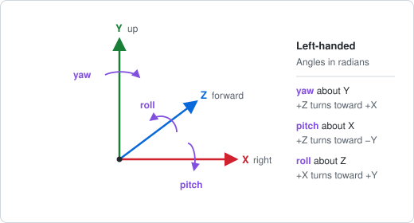

# Transformations

[← Back to the README](../README.md)

- [Choosing a representation](#choosing-a-representation)
- [AffineTransform](#affinetransform)
- [Matrix4](#matrix4)
- [Euler angles](#euler-angles)
- [YawPitchRoll](#yawpitchroll)
- [Converting between rotation representations](#converting-between-rotation-representations)
- [Transforming geometry](#transforming-geometry)

The conventions used here (row vectors, left-to-right composition, rotation direction, axis meaning) are defined in
[Conventions](Conventions.md).

## Choosing a representation

| Type | Stores | Use it for |
| --- | --- | --- |
| `Matrix3` | 3×3 linear map | Rotation, scale and shear without translation; orientation bases |
| `AffineTransform` | 4×3 matrix: a `Matrix3` basis plus an origin | Object and camera placement; the default choice for rigid and affine transformations |
| `Matrix4` | 4×4 matrix | Homogeneous transformations, anything that needs the fourth column |
| `Quaternion` | 4 components | Compact rotations, interpolation, accumulating rotations |
| `Euler` | 3 angles and an order | Editing and serialization in a specific axis order |
| `YawPitchRoll` | 3 angles | Human-friendly heading, elevation and bank |

## AffineTransform

Header: `<Mathematics/Transform/AffineTransform.hpp>`. Alias: `AffineTransform`.

A 4×3 matrix. Rows 0 to 2 are the basis (the transformed X, Y and Z axes) and row 3 is the origin (the translation).
A point is transformed as `p*basis + origin`.

### Construction

```cpp
AffineTransform zero;                                               // all zeros - not a valid transformation
AffineTransform identity{ Identity() };                             // or AffineTransform::IDENTITY
AffineTransform fromParts(Matrix3::makeRotation(Axis::Y, 1.f), Vector3(1.f, 2.f, 3.f));    // basis, origin
AffineTransform fromRows(Vector3::UNIT_X, Vector3::UNIT_Y, Vector3::UNIT_Z, Vector3(1.f, 2.f, 3.f));
AffineTransform linear(Matrix3::makeScaling(2.f));                  // no translation
```

> [!NOTE]
> The default constructor produces a **zero** matrix. Start from `AffineTransform::IDENTITY` or a `make` function
> when building a transformation step by step.

"Look at" constructors place an object at `origin` with its Z axis pointing along `forward`:

```cpp
AffineTransform camera(Vector3::UNIT_Y, Vector3(1.f, 0.f, 0.f), Vector3(5.f, 5.f, 5.f));   // up, forward, origin
AffineTransform turret(Vector3(1.f, 0.f, 0.f), Vector3(5.f, 5.f, 5.f));                    // forward, origin
```

### Factory functions

Each `makeX` has a matching in-place `setX`. Wherever a rotation is expected, it can be given as `(Axis, angle)`,
`(axis vector, angle)`, a `YawPitchRoll`, an `Euler` or a `Quaternion`.

| Function | Description |
| --- | --- |
| `makeTranslation(t)` | Translation |
| `makeScaling(s)`, `makeScaling(f)` | Non-uniform or uniform scale |
| `makeRotation(rotation)` | Rotation |
| `makeRotationTranslation(rotation, t)` | Rotation, then translation |
| `makeScalingRotation(s, rotation)` | Scale, then rotation |
| `makeScalingTranslation(s, t)` | Scale, then translation |
| `makeScalingRotationTranslation(s, rotation, t)` | Scale, then rotation, then translation |
| `makeShearing(xy, xz, yx, yz, zx, zy)` | Shear |
| `makeReflection(plane)` | Mirror image across a plane |

```cpp
AffineTransform placement = AffineTransform::makeScalingRotationTranslation(
    Vector3(2.f), Axis::Z, radians(90.f), Vector3(10.f, 0.f, 0.f));

transform(Vector3(1.f, 1.f, 1.f), placement);       // (8, 2, 2)
```

### Member functions

| Member | Description |
| --- | --- |
| `getBasis()`, `setBasis(m)` | The 3×3 part, as a `Matrix3` |
| `getOrigin()`, `setOrigin(t)` | The translation |
| `m[i]`, `getRow(i)`, `getColumn(i)` | Rows as `Vector3`; columns as `Vector4` |
| `getScaleComponent()` | Scale along each transformed axis |
| `set(...)`, `setZero()`, `setIdentity()` | Assign |
| `concatenate(m)`, `preConcatenate(m)` | Append or prepend a transformation |
| `translate(v)` | Append a translation |
| `scale(v)`, `scale(f)`, `preScale(v)`, `preScale(f)` | Append or prepend a scale |
| `invert()`, `setInverse(m)` | General inverse |
| `invertOrthogonal()`, `setInverseOrthogonal(m)` | Fast inverse, valid only for rotation plus translation |
| `orthonormalize()` | Make the basis orthonormal |
| `isIdentity()`, `isApproxIdentity()`, `approxEquals(...)`, `isFinite()` | Predicates |
| `isApproxOrthogonal()`, `hasApproxUniformScaling()` | Predicates on the basis |

### Free functions

| Function | Description |
| --- | --- |
| `transform(v, m)` | Transforms the point `v`. `v.transform(m)` does the same in place |
| `concatenate(a, b)`, up to four arguments | Applies `a`, then `b`, ... |
| `inverse(m)` | General inverse |
| `inverseOrthogonal(m)` | Fast inverse for rotation plus translation |

`AffineTransform` has no `operator*`; use `concatenate` and `transform`. To transform a *direction*
rather than a point, multiply by the basis: `direction*m.getBasis()`.

```cpp
AffineTransform world = AffineTransform::makeRotation(Axis::Y, radians(90.f));
world.translate(Vector3(1.f, 0.f, 0.f)).scale(2.f);                 // rotate, then move, then scale

transform(Vector3::UNIT_Z, world);                                  // (4, 0, 0)

AffineTransform local = inverse(world);
transform(transform(Vector3(1.f, 1.f, 1.f), world), local);         // (1, 1, 1)
```

## Matrix4

Header: `<Mathematics/Algebra/Matrix4.hpp>`. Aliases: `Matrix4`, `Matrix4f`, `Matrix4d`.

A full 4×4 matrix, used with `Vector4`. The translation is stored in the last row (`m30`, `m31`, `m32`). The general
matrix interface is described in [Algebra](Algebra.md#matrices); `Matrix4` adds the same transformation factories as
`AffineTransform`:

`makeTranslation`, `makeScaling`, `makeRotation`, `makeRotationTranslation`, `makeScalingRotation`,
`makeScalingTranslation`, `makeScalingRotationTranslation`, `makeShearing`, `makeReflection`, each with a matching
`setX`, plus the members `translate(v)`, `scale(v)` and `preScale(v)`.

`Matrix4` converts implicitly from `Matrix2`, `Matrix3` and `AffineTransform`, filling the rest with identity:

```cpp
Matrix4 m = AffineTransform::makeTranslation(Vector3(1.f, 2.f, 3.f));

Vector4(1.f, 2.f, 3.f, 1.f)*m;      // (2, 4, 6, 1): a point (w = 1) is translated
Vector4(1.f, 2.f, 3.f, 0.f)*m;      // (1, 2, 3, 0): a direction (w = 0) is not

inverse(m);                         // translation by (-1, -2, -3)
```

The library does not include projection matrix builders; view volumes are modeled geometrically with
[`SymmetricFrustum`](Geometry.md#symmetricfrustum).

## Euler angles

Headers: `<Mathematics/Transform/Euler.hpp>`, `<Mathematics/Transform/EulerOrder.hpp>`. Alias: `Euler`.

`Euler` stores three angles `x, y, z` - the rotations about the X, Y and Z axes - together with the `order` in which
they are applied.

| `EulerOrder` | Rotations are applied about |
| --- | --- |
| `XYZ` | X, then Y, then Z |
| `XZY` | X, then Z, then Y |
| `YZX` | Y, then Z, then X |
| `YXZ` | Y, then X, then Z |
| `ZXY` | Z, then X, then Y (the order used by `YawPitchRoll`) |
| `ZYX` | Z, then Y, then X |
| `UNSPECIFIED` | No order; such a value converts to the identity rotation |

`pack(axis1, axis2, axis3)` returns the `EulerOrder` for a sequence of `Axis` values.

```cpp
Euler e(radians(10.f), radians(20.f), radians(30.f), EulerOrder::XYZ);

Matrix3 m = Matrix3::makeRotation(e);
// same as: makeRotation(Axis::X, e.x)*makeRotation(Axis::Y, e.y)*makeRotation(Axis::Z, e.z)

Euler back(m, EulerOrder::XYZ);                     // (10, 20, 30) degrees again
Euler reordered(m, EulerOrder::ZYX);                // the same rotation expressed in another order
```

| Constructor | Description |
| --- | --- |
| `Euler(order)` | Zero angles with the given order |
| `Euler(x, y, z, order)` | Angles and order |
| `Euler(matrix, order)`, `Euler(quaternion, order)` | Decomposes a rotation into the given order |
| `Euler(yawPitchRoll)` | The same angles in `ZXY` order |
| `Euler(euler, order)` | Copies the angles and **replaces the order tag** without converting |

> [!IMPORTANT]
> `Euler(euler, order)` reinterprets the angles; it does not produce an equivalent rotation. To express a rotation in
> a different order, convert through a matrix or quaternion: `Euler(Matrix3::makeRotation(e), EulerOrder::ZYX)`.

Members: `set(x, y, z)`, `set(x, y, z, order)`, `setZero()`, `setZero(order)`, `negate()`, `isZero()`,
`isApproxZero()`, `approxEquals(...)`, `isFinite()`. Constants: `ZERO` (unspecified order) and `ZERO_XYZ`,
`ZERO_XZY`, `ZERO_YZX`, `ZERO_YXZ`, `ZERO_ZXY`, `ZERO_ZYX`.

Decomposition has the usual gimbal lock limitation: when the middle angle reaches ±90° the other two are not unique.

## YawPitchRoll

Header: `<Mathematics/Transform/YawPitchRoll.hpp>`. Alias: `YawPitchRoll`.

Three angles with a fixed meaning in the library's coordinate system (X right, Y up, Z forward). The rotation is
applied as roll, then pitch, then yaw.

<p align="center">
  
</p>

| Angle | Axis | A positive angle |
| --- | --- | --- |
| `yaw` | Y | turns the heading to the right (+Z toward +X) |
| `pitch` | X | lowers the nose (+Z toward -Y) |
| `roll` | Z | banks +X toward +Y |

```cpp
YawPitchRoll heading(radians(90.f), 0.f, 0.f);
heading.toForward();                                    // (1, 0, 0): facing +X

YawPitchRoll::fromForward(Vector3(1.f, 0.f, 0.f));      // yaw = 90 degrees, pitch = 0, roll = 0
YawPitchRoll(0.f, radians(45.f), 0.f).toForward();      // (0, -0.707107, 0.707107): looking down
```

| Member | Description |
| --- | --- |
| `YawPitchRoll(yaw, pitch, roll)` | From angles |
| `YawPitchRoll(matrix)`, `YawPitchRoll(quaternion)`, `YawPitchRoll(euler)` | Conversion; explicit |
| `fromForward(forward, roll = 0)` | The yaw and pitch that face a direction |
| `toForward()` | The unit forward vector |
| `set(yaw, pitch, roll)`, `setZero()`, `negate()` | Assign |
| `isZero()`, `isApproxZero()`, `approxEquals(...)`, `isFinite()` | Predicates |

## Converting between rotation representations

Every representation converts to every other one, either through a constructor or through `makeRotation`.

| From ↓ / To → | `Matrix3` | `Quaternion` | `Euler` | `YawPitchRoll` |
| --- | --- | --- | --- | --- |
| `Matrix3 m` | | `Quaternion(m)` | `Euler(m, order)` | `YawPitchRoll(m)` |
| `Quaternion q` | `Matrix3(q)`, `Matrix3::makeRotation(q)` | | `Euler(q, order)` | `YawPitchRoll(q)` |
| `Euler e` | `Matrix3(e)`, `Matrix3::makeRotation(e)` | `Quaternion(e)` | | `YawPitchRoll(e)` |
| `YawPitchRoll r` | `Matrix3(r)`, `Matrix3::makeRotation(r)` | `Quaternion(r)` | `Euler(r)` | |
| Axis and angle | `Matrix3::makeRotation(axis, angle)` | `Quaternion::fromAxisAngle(axis, angle)` | | |
| Two directions | | `arc(from, to)` | | |
| Forward (and up) | `Matrix3(forward)`, `Matrix3(up, forward)` | | | `YawPitchRoll::fromForward(forward)` |

The same rotation arguments are accepted by the `makeRotation...` and `makeScalingRotation...` factories of
`AffineTransform` and `Matrix4`. Conversions from quaternions expect a unit quaternion.

```cpp
Quaternion q = Quaternion::fromAxisAngle(Vector3::UNIT_Y, radians(90.f));

Matrix3 m(q);
YawPitchRoll r(q);                  // yaw = 90 degrees
Euler e(q, EulerOrder::XYZ);
Quaternion again(m);                // q, up to sign
```

## Transforming geometry

Most primitives have `translate(offset)` and `transform(...)` members that accept a `Matrix3` or an
`AffineTransform` and modify the primitive in place:

```cpp
Ray3 ray(Vector3::ZERO, Vector3::UNIT_Z);
ray.transform(world);                           // origin as a point, direction as a direction

Triangle3 triangle(a, b, c);
triangle.translate(Vector3(0.f, 1.f, 0.f));
```

Some shapes cannot represent an arbitrary transformation exactly and document their behavior:

| Type | `transform` behavior |
| --- | --- |
| `Plane`, `HalfSpace` | Take an `orthogonal` flag. Pass `true` when the transformation is a pure rotation (plus translation) to skip the inverse-transpose computation |
| `AxisAlignedBox` | Becomes the axis-aligned bounds of the transformed box, which is exact for any affine transformation |
| `OrientedBox` | Takes an `orthogonal` flag; with `false` the basis is re-orthonormalized after the transformation and its scale is moved into the half-dimensions |
| `Sphere`, `Ellipsoid`, `Cylinder`, `Capsule`, `Cone`, `Torus`, `ConvexPolyhedron` | Take the same `orthogonal` flag. Pass `true` when the transformation is known to be orthonormal |
| `Circle2`, `AxisAlignedRectangle`, `SymmetricFrustum` | Provide `translate` only |

To keep a box tight under rotation, convert it to an `OrientedBox` instead:
`OrientedBox(axisAlignedBox, transformation)`.
