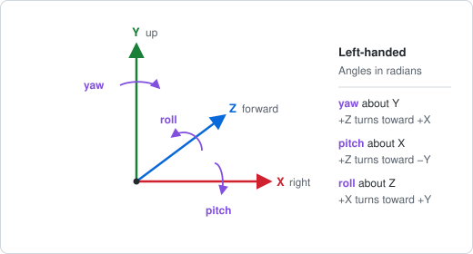

# Mathematics

[](https://github.com/pmrochen/Mathematics/actions/workflows/tests.yml)


[](LICENSE)

**Mathematics** is a linear algebra and geometry library written in header-only C++20. It provides the vector, matrix,
quaternion and transformation types needed by real-time 3D applications, a broad set of geometric primitives, and the
containment, distance and intersection queries between them.

```cpp
#include <Mathematics/Mathematics.hpp>
#include <iostream>

using namespace mathematics;

int main()
{
    // Scale by 2, rotate 90 degrees about Y, then move 10 units along X
    AffineTransform transformation = AffineTransform::makeScalingRotationTranslation(
        Vector3(2.f), Quaternion::fromAxisAngle(Vector3::UNIT_Y, radians(90.f)), Vector3(10.f, 0.f, 0.f));

    std::cout << transform(Vector3::UNIT_X, transformation) << "\n";    // 10 0 -2

    // Cast a ray against a sphere
    Ray3 ray(Vector3(0.f, 0.f, -5.f), Vector3::UNIT_Z);
    Sphere sphere(Vector3::ZERO, 1.f);

    if (auto hit = ray.findIntersection(sphere))                        // std::optional<Interval>
        std::cout << ray.evaluate(hit->getMinimum()) << "\n";           // 0 0 -1
}
```

## Contents

- [Features](#features)
- [Requirements](#requirements)
- [Getting started](#getting-started)
- [Configuration](#configuration)
- [Conventions at a glance](#conventions-at-a-glance)
- [Documentation](#documentation)
- [Running the tests](#running-the-tests)
- [License](#license)

## Features

- **Algebra:** Vectors and matrices in 2D, 3D, and 4D, transformations using translations, rotations, and scale,
  rotational representations including matrices, quaternions, axis-angle, and Euler angles.
- **Primitives:** Geometric primitives for 2D and 3D - line, ray, line segment, plane, half-space, aligned and oriented
  box, triangle, quadrilateral, circle, sphere, ellipsoid, tetrahedron, cylinder, cone, capsule, torus, frustum.
- **Bezier Curves:** Cubic curves in 2D and 3D with evaluation, tangents, arc length and arc-length parameterization.
- **Shapes:** Complex 3D geometric shapes - convex polyhedron, triangle mesh, tetrahedral mesh.
- **Analysis:** Containment, distance, and intersection queries of geometric primitives and complex shapes.
- **Miscellaneous:** Intervals, polygon triangulation, LU decomposition, Romberg integration, random number, and Perlin
  Noise generators.
- **Single or double precision:** Every type is a template over the scalar type; short aliases (`Vector3`, `Matrix4`,
  `Sphere`, ...) select `float` or `double` with one build option.
- **SIMD:** Single precision vectors, matrices, quaternions and planes are specialized for SSE through the companion
  [Simd](https://github.com/pmrochen/Simd) library, with a portable scalar fallback everywhere else.
- **Standard library friendly:** Structured bindings, `std::hash`, tuple conversions, stream operators and
  archive-style serialization hooks.

## Requirements

- A C++20 compiler. The library is continuously tested with GCC 14, Clang 18, AppleClang and MSVC (Visual Studio 2022)
  on Linux, macOS (arm64) and Windows.
- CMake 3.25 or newer (optional, but recommended).
- No third-party dependencies apart from the bundled [Simd](https://github.com/pmrochen/Simd) submodule. The unit
  tests download [doctest](https://github.com/doctest/doctest) at configure time.

## Getting started

Clone the repository together with its submodule:

```bash
git clone --recurse-submodules https://github.com/pmrochen/Mathematics.git
```

Add it to a CMake project and link the `Core::Mathematics` interface target, which carries the include directories,
the C++20 requirement and all configuration definitions:

```cmake
add_subdirectory(Mathematics)

target_link_libraries(MyApplication PRIVATE Core::Mathematics)
```

Then include the umbrella header, or only the headers you need:

```cpp
#include <Mathematics/Mathematics.hpp>          // everything
#include <Mathematics/Algebra/Vector3.hpp>      // a single type
```

See [Getting Started](Docs/GettingStarted.md) for `FetchContent`, non-CMake builds and the build presets.

## Configuration

| CMake option | Default | Description |
| --- | --- | --- |
| `MATHEMATICS_DOUBLE_PRECISION` | `OFF` | Makes the unsuffixed aliases (`Vector3`, `Matrix3`, `Sphere`, ...) refer to the `double` instantiations instead of `float`. |
| `MATHEMATICS_ENABLE_SIMD` | `ON` | Links the Simd library and enables the SIMD specializations of the single precision types. |
| `MATHEMATICS_ENABLE_SSE4` | `OFF` | Compiles the tests with SSE4.2 enabled. |
| `MATHEMATICS_ENABLE_AVX` | `OFF` | Compiles the tests with AVX enabled. |
| `MATHEMATICS_ENABLE_AVX2` | `OFF` | Compiles the tests with AVX2 enabled. |
| `MATHEMATICS_WITH_TESTS` | `ON` when top-level | Adds the `MathematicsTests` target. |
| `MATHEMATICS_ENABLE_QUICKHULL` | `ON` | Reserved for convex hull generation; currently has no effect. |

The instruction set options only add compiler flags to the library's own test build. An application that consumes the
library chooses its target instruction set with its own compiler flags (for example `-mavx2` or `/arch:AVX2`); with
SIMD enabled, x86-64 builds need at least SSE4.1.

## Conventions at a glance

| Topic | Convention |
| --- | --- |
| Namespace | `mathematics` (templates live in `mathematics::templates`) |
| Vectors | Row vectors, transformed as `v*M`; `transform(v, m)` is equivalent |
| Matrices | Row-major storage, translation in the last row |
| Composition | `concatenate(a, b)` applies `a` first, then `b` |
| Coordinate system | Left-handed: X right, Y up, Z forward |
| Angles | Radians; use `radians()` and `degrees()` to convert |
| Planes | `dot(normal, p) + d = 0`; half-spaces contain the points where `dot(normal, p) + d <= 0` |
| Ray and line queries | Return the parameter `t` such that `origin + t*direction` is the hit point |

<p align="center">
  
</p>

The details, including what changes when SIMD is enabled, are described in [Conventions](Docs/Conventions.md).

## Documentation

| Guide | Contents |
| --- | --- |
| [Getting Started](Docs/GettingStarted.md) | Installation, CMake integration, build options, presets, running the tests |
| [Conventions](Docs/Conventions.md) | Coordinate system, matrix layout, naming, precision, tolerances, SIMD, standard library integration |
| [Algebra](Docs/Algebra.md) | Scalar functions, constants, `Vector2/3/4`, `Matrix2/3/4`, `Quaternion`, LU decomposition |
| [Transformations](Docs/Transformations.md) | `AffineTransform`, `Matrix4`, `Euler`, `YawPitchRoll` and conversions between rotation representations |
| [Geometry](Docs/Geometry.md) | Lines, rays, segments, planes, polygons, boxes, round solids, frustum, Bezier curves |
| [Queries](Docs/Queries.md) | Containment, distance and intersection queries, with a support matrix |
| [Meshes](Docs/Meshes.md) | `ConvexPolyhedron`, `TriangleMesh`, `TetrahedralMesh`, polygon triangulation |
| [Utilities](Docs/Utilities.md) | `Interval`, `Random`, Perlin noise, Romberg integration, spline bases |

## Running the tests

```bash
cmake -S . -B build -DCMAKE_BUILD_TYPE=Release -DMATHEMATICS_ENABLE_AVX2=ON
```

```bash
cmake --build build --target MathematicsTests --parallel
```

```bash
ctest --test-dir build --output-on-failure
```

On hardware other than x86-64 leave the instruction set options off; the tests then exercise the portable code path.

## License

Code released under [the MIT license](https://github.com/pmrochen/Mathematics/blob/main/LICENSE).
